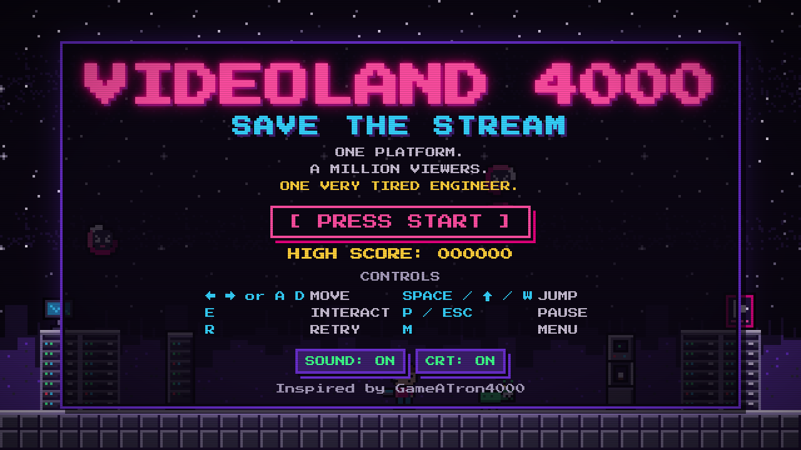
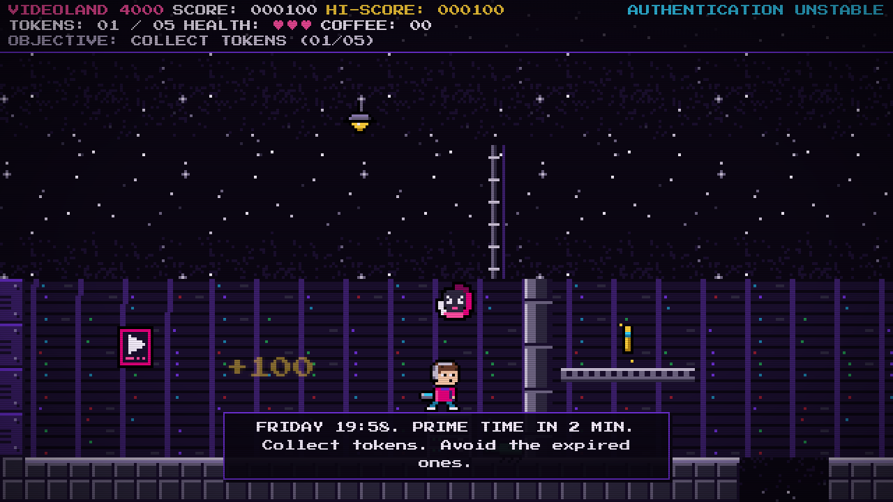
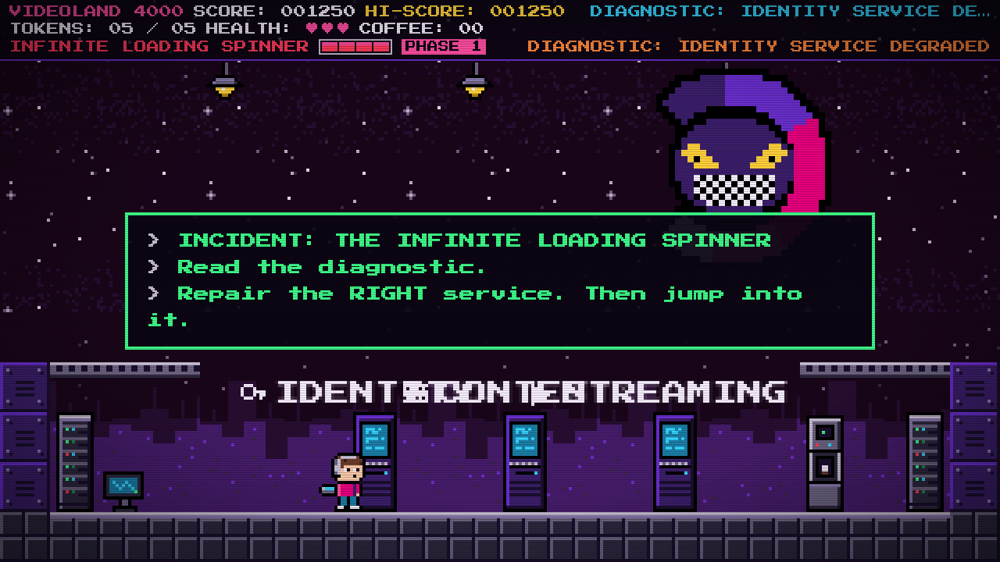
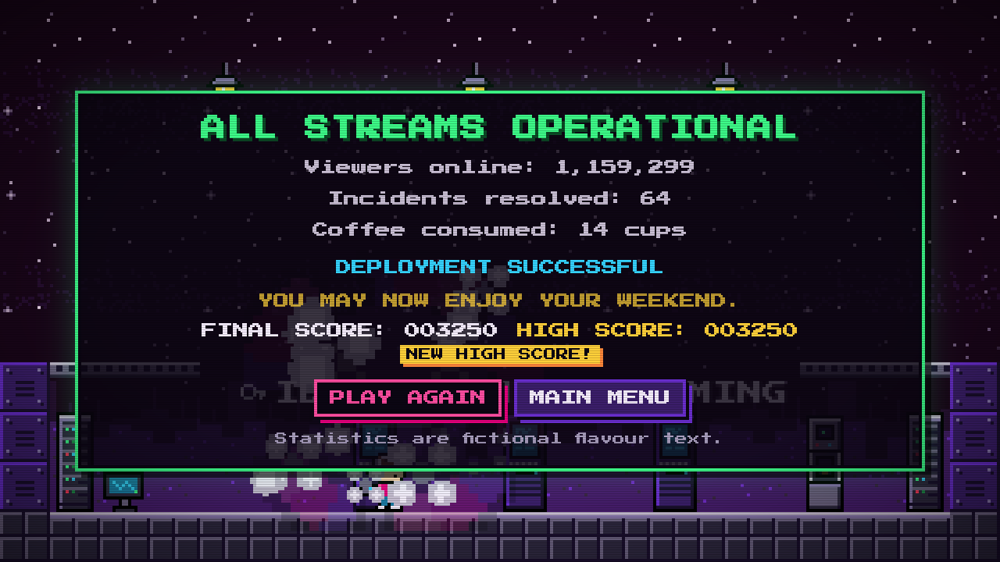

# VIDEOLAND 4000 — SAVE THE STREAM

> *One platform. A million viewers. One very tired engineer.*

A retro 1980s arcade platformer for the browser. It is Friday evening in the Netherlands, prime time
is approaching, and the (entirely fictional) streaming platform is falling apart: expired tokens are
escaping into production, buffering spinners are multiplying, and authentication is failing. You are
a tiny pixel-art engineer with a laptop. Collect valid tokens, repair the authentication terminal,
reach the exit and defeat **The Infinite Loading Spinner** before the weekend is cancelled.

Built on the architecture of [GameATron4000](https://github.com/amolenk/GameATron4000) by Sander
Molenkamp (Blazor WebAssembly + Phaser), transformed from a point-and-click adventure engine into an
arcade game. See [docs/ARCHITECTURE.md](docs/ARCHITECTURE.md) for how it fits together.

| Title | The Login Dungeon |
|-------|-------------------|
|  |  |

| The Infinite Loading Spinner | Victory |
|------------------------------|---------|
|  |  |

## The game

| Flow | What happens |
|------|--------------|
| Boot screen | A fictional "VIDEOLAND SYSTEMS" self-test (skippable). |
| Title screen | High score, controls, sound/CRT toggles, animated attract scene. |
| Level 1 — The Login Dungeon | Side-scrolling level: platforms, pits, glitch hazards, 6 tokens (5 required), coffee, three power-ups, three enemy types, an authentication terminal, two checkpoints and a locked exit. |
| Final encounter — Prime Time | The Infinite Loading Spinner: three phases. It is invulnerable while spinning. Read the diagnostic, repair the **right** service terminal to stun it, then jump into it. Restarting the wrong service does nothing. Classic. |
| Victory / game over | Fictional incident statistics, final score, retry (from checkpoint) or main menu. |

Enemies: the **Buffering Spinner** (slow, floaty, persistent), the **Expired Token** (erratic, phases in
and out of existence with a warning) and the **Bug** (patrols platforms, turns at edges). All three can
be stomped from above.

Power-ups: **Coffee** (+1 health, never above max), **Cache Boost** (enemies slowed for 8 s),
**Circuit Breaker** (freezes nearby enemies for 4 s) and **Rollback** (the next incident is reverted:
no damage, and you are returned to a safe position from a moment ago).

Scoring (configurable in `game.yaml`): token 100 · coffee 50 · enemy 150 · checkpoint 250 ·
objective 500 · boss 2000. The high score is stored in `localStorage` (validated; falls back to memory).

## Controls

| Input | Action |
|-------|--------|
| ← → or A D | Move |
| Space / ↑ / W | Jump (hold for a higher jump) |
| E | Interact with terminals |
| P / Escape | Pause / resume |
| R | Retry after game over (from the checkpoint when available) |
| M | Main menu (from pause, game over or victory) |
| N | Toggle sound |
| Enter / Space | Start / skip boot and intro |

Menus work with mouse and touch; on touch devices simple on-screen controls appear. The game is fully
playable without sound; a CRT scanline overlay can be switched off, and `prefers-reduced-motion`
disables screen shake, flashes and flicker.

## Prerequisites

* [.NET SDK 8.0](https://dotnet.microsoft.com/download/dotnet/8.0) (Blazor WebAssembly; no extra workloads needed)
* A modern desktop browser (Chrome, Edge, Firefox, Safari)
* Optional: Python 3.9+ (stdlib only) to rebuild the sprite atlas, Node.js 18+ for the browser smoke test

## Run the game locally

```sh
dotnet run --project src/BlazorUI
```

Then open <http://localhost:5237>. The first load downloads the .NET runtime (a few MB); later loads
are cached. For a production build:

```sh
dotnet publish src/BlazorUI/BlazorUI.csproj -c Release -o publish
# serve publish/wwwroot with any static web server (it is a static site)
```

## Tests

```sh
# Core game-logic tests (xUnit): physics, collectibles, enemies, objectives, boss, state machine, scoring
dotnet test src/Core.Tests/Core.Tests.csproj

# Browser smoke test (Playwright + Chromium): boots the real app and plays the whole game — boot, title,
# level, token pickup, jump, pause/resume, terminal, checkpoint, exit, the full boss fight, victory,
# game over and retry — checking the HUD, persistence, frame rate and the absence of console errors.
# Starts `dotnet run` itself (or set GAME_URL to an already running instance).
cd tests/e2e && npm install && npx playwright install chromium && npm run smoke

# Renderer harness checks (JavaScript renderer + audio without .NET)
cd tests/e2e && npm run harness
```

Opening the game with `?dev=1` exposes `window.vl4000Debug(command)` in the browser console
(`state`, `tokens`, `terminal`, `checkpoint`, `exit`, `repair`, `stun`, `boss-touch`, `heal`, `hurt`).
It only teleports the player or triggers the same interactions a player would, and is what the smoke
test uses to reach later parts of the game quickly. Without the query parameter it does not exist.

The Core tests also validate the real level files: every collectible, the terminal, the checkpoint and
the exit must be reachable with the actual jump physics, and both boss-arena layouts must share the
same solid geometry so nothing can ever be trapped.

## Deploy (Cloudflare Pages, free)

The game is a static site, so it can be hosted anywhere that serves `.wasm` files. The GitHub Actions
workflow (`.github/workflows/build.yml`) builds, tests and publishes on every push, and deploys to
**Cloudflare Pages** on pushes to `main` once two repository secrets exist. One-time setup:

1. Create the Pages project (either in the Cloudflare dashboard: *Workers & Pages → Create → Pages →
   Upload assets*, name it `vl-4000-game`; or locally with `npx wrangler login` followed by
   `npx wrangler pages project create vl-4000-game --production-branch main`).
2. Create an API token at *My Profile → API Tokens* with the permission **Account → Cloudflare Pages → Edit**.
3. Copy your **Account ID** (Workers & Pages overview, right-hand side).
4. In the GitHub repository, add the secrets `CLOUDFLARE_API_TOKEN` and `CLOUDFLARE_ACCOUNT_ID`
   (*Settings → Secrets and variables → Actions*).
5. Push to `main` (or re-run the workflow). The site appears at `https://vl-4000-game.pages.dev`.

Deep links such as `/play/1` work because Cloudflare Pages serves `index.html` for unknown routes
when the site has no `404.html`. Nothing is stored server-side: the high score lives in the player's
browser. Other free options that work the same way: Azure Static Web Apps (the repository already
contains `staticwebapp.config.json`), Netlify, or GitHub Pages (needs `.nojekyll`, a `404.html` copy of
`index.html` and a matching `<base href>`).

## Project layout

```
src/Core              pure C# game model (state machine, fixed-step physics, entities, level parser, scoring)
src/Infrastructure    Phaser bridge (JS interop), mediator, YAML/HTTP repositories, localStorage persistence
src/BlazorUI          Blazor WebAssembly host: pages, HUD/menu components, CSS, JavaScript, game disk content
src/Core.Tests        xUnit tests
tools/atlas           pixel-art → sprite atlas generator (text pixel-maps, stdlib Python)
tools/renderer-harness  standalone HTML harness for the JavaScript renderer
tests/e2e             Playwright smoke test
docs/ARCHITECTURE.md  contracts: frame snapshot, input, sounds, messages, level legend, sprite catalogue
```

## Content and art pipeline

* Levels are ASCII tile maps in `src/BlazorUI/wwwroot/games/disk001/levels/*.yaml` (legend in
  `docs/ARCHITECTURE.md` §6). Tweak enemies, pickups and platforms by editing characters.
* Sprites are authored as text pixel-maps in `tools/atlas/frames_*.py` and compiled with
  `python3 tools/atlas/build_atlas.py --preview` into `sprites.png` + `sprites.json`.
* Sound effects and music are synthesised at runtime with WebAudio (`wwwroot/js/audio.js`); there are
  no audio files.

## Licensing and attribution

* Game code, artwork, level design, texts and sounds in this repository are original work created for
  this project.
* [Phaser 3.55.2](https://phaser.io) — MIT License (bundled as `wwwroot/js/phaser.min.js`).
* [Press Start 2P](https://fonts.google.com/specimen/Press+Start+2P) by CodeMan38 — SIL Open Font License 1.1
  (`wwwroot/assets/fonts/PressStart2P-OFL.txt`).
* Architecture inspired by GameATron4000 (Sander Molenkamp). No code, artwork or fonts from that
  repository are included.
* "Videoland" is a streaming service of RTL Nederland. This is a fan-made, fictional arcade game for
  colleagues; it contains no real logos, production systems, metrics or infrastructure details.
